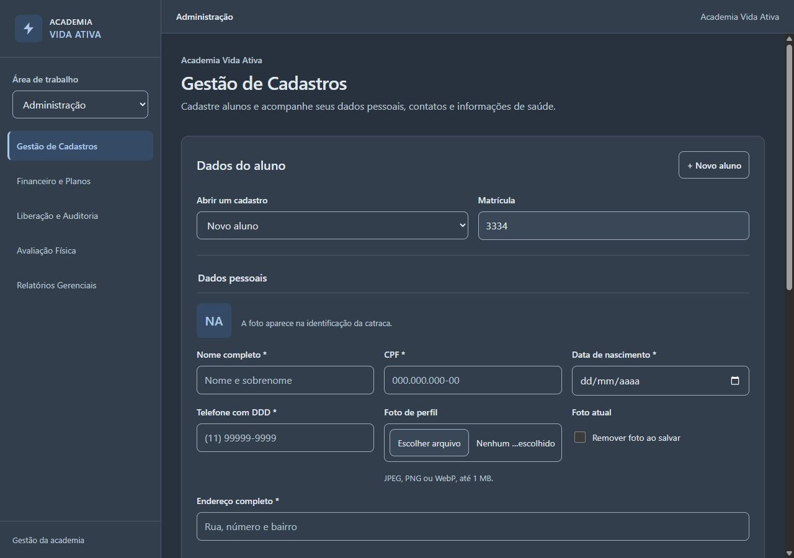

# Tema grafite suave e azul — 09/10/2026

A paleta foi substituída nos estilos compartilhados dos seis módulos, preservando layout, tipografia, espaçamentos, APIs locais, registros e regras operacionais. O branco puro foi retirado, os controles nativos usam `color-scheme: dark` e o `theme-color` é `#28323E`.

## Paleta aplicada

| Variável | Cor |
|---|---|
| `--bg` | `#28323E` |
| `--surface` | `#323E4C` |
| `--surface-soft` | `#3A4757` |
| `--border` | `#4A5869` |
| `--control-border` | `#9EACBD` |
| `--accent` | `#ACC8EB` |
| `--accent-hover` | `#BED3EC` |
| `--accent-soft` | `#354B65` |
| `--on-accent` | `#1E2C3D` |
| `--text` | `#E1E7EF` |
| `--muted` | `#BDC8D5` |
| `--placeholder` | `#B4C0CF` |
| `--disabled-bg` | `#35414F` |
| `--green` | `#A4D4B7` |
| `--green-soft` | `#334D40` |
| `--green-border` | `#526F5E` |
| `--yellow` | `#E2C88D` |
| `--yellow-soft` | `#514737` |
| `--yellow-border` | `#76664A` |
| `--red` | `#E5B1B1` |
| `--red-soft` | `#553F45` |
| `--red-border` | `#79555E` |

## Validação

- Os 40 cenários de regressão passaram; os testes de consistência agora exigem o tema escuro. Resultado em [TESTES-FRONTEND.json](TESTES-FRONTEND.json).
- Os seis módulos foram inspecionados em 1280 × 900 e 360 × 800 px, totalizando 12 combinações. Não houve rolagem horizontal da página; o Financeiro mantém a rolagem interna da tabela.
- Foram medidos 706 pares de texto e fundo com estilos computados no navegador. O menor contraste observado foi 5.16:1, acima do critério de 4,5:1. As bordas de controles da paleta têm contraste mínimo de 4,10:1 nas superfícies previstas, acima de 3:1.
- Foco por teclado confirmado no formulário e na navegação: contorno azul de 3 px, com `:focus-visible`. O campo somente leitura mantém a superfície secundária.
- Sucesso, atenção e bloqueio foram acionados pela interface da Portaria e conferidos visualmente, com mensagens explícitas e textos acima de 4,5:1. Os registros gerados nessa verificação ficaram em `localhost`, separado da apresentação em `127.0.0.1`.
- A apresentação foi recarregada com a nova paleta, deixada em Gestão de Cadastros e aberta em [http://127.0.0.1:8765/](http://127.0.0.1:8765/).

Capturas e medições: [visual/tema-grafite/verificacoes.json](visual/tema-grafite/verificacoes.json). Os relatórios do tema claro permanecem como histórico. A aplicação continua sendo uma apresentação em HTML, CSS e JavaScript com dados fictícios locais; o conforto visual será avaliado pelo cliente.

